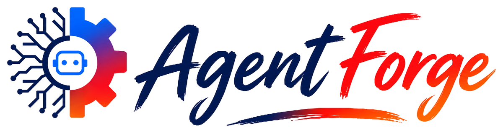

<p align="center"></p>

# Tutorial 3: Build your own research MCP server

**AgentForge Workshop · Tutorial 3 hands-on · 50 minutes.** Author: Kosiachevskyi Dmytro (NUS).

Can't install it on your laptop? Use the Colab version instead: [](https://colab.research.google.com/github/AgentForgeWorkshop/Tutorials/blob/main/Tutorial3_mcp_skills/03_mcp_skills_colab.ipynb)

You will build both halves of a capable research agent: **MCP** for access (what it can reach) and
**Agent Skills** for the workflow (how it does the job). Five parts, in the order of the talk:

| Part | What you do | You provide | Time |
|---|---|---|---|
| Setup | Install, choose your folder, paste your key ([Quick start](#quick-start)) | Your folder | 6 min |
| [A · MCP](docs/A-mcp-access.md) | Discover your server, connect your app, search your papers and the literature | Nothing | 10 min |
| [B · Agent Skills](docs/B-skills.md) | A calculator skill and a checked lay abstract; progressive disclosure | Nothing | 10 min |
| [C · Together](docs/C-together.md) | A cited literature review: MCP access plus a skill's method | Your API key | 8 min |
| [D · Platform](docs/D-platform.md) | Valency, a hosted MCP server, in ChatGPT with no code | A free Valency sign-in | 6 min |
| [E · Decide](docs/E-decide.md) | MCP, a skill, or both? For your own research tasks | Nothing | 3 min |

Something not working? See [Troubleshooting](docs/troubleshooting.md).

## Quick start

You need Python 3.10 or newer. Check with `python3 --version` (Windows: `py --version`).

**macOS or Linux**

```bash
git clone https://github.com/AgentForgeWorkshop/Tutorials.git
cd Tutorials/Tutorial3_mcp_skills
python3 -m venv .venv
source .venv/bin/activate
pip install -r requirements.txt
python get_demo_papers.py
python setup_workshop.py
```

**Windows (PowerShell)**

```powershell
git clone https://github.com/AgentForgeWorkshop/Tutorials.git
cd Tutorials/Tutorial3_mcp_skills
py -m venv .venv
.venv\Scripts\Activate.ps1
pip install -r requirements.txt
python get_demo_papers.py
python setup_workshop.py
```

No git? On [the Tutorials page](https://github.com/AgentForgeWorkshop/Tutorials), click **Code → Download ZIP**, unzip it, and open a terminal in the `Tutorial3_mcp_skills` folder.

`get_demo_papers.py` downloads three real review papers on semiconductors, the hands-on's example
library. The setup then asks for your library folder (press Enter for those papers, or drag in your own) and your API key: the
same OpenRouter key as in Tutorial 1, a free Google AI Studio key, or an Anthropic or OpenAI key. Both
are saved in `.env` on your computer, which git ignores. It then prints how to connect your AI
app. **Then start with [Part A](docs/A-mcp-access.md).**

## How it fits together

```text
 Your AI app  <--- MCP --->  server.py  ---> your folder of documents
 Claude, Cursor, VS Code,    11 tools   ---> OpenAlex, arXiv, Europe PMC
 Gemini CLI, Codex, chat.py  3 skills   ---> your AI API key, for automatic reviews
```

| File | What it does |
|---|---|
| `server.py` | The MCP server. **Read this one first.** |
| `research_tools/` | Plain Python with no MCP: library, online search, review, lay abstract checks |
| `skills/` | The know-how: calculator, lay-abstract, literature-review, and a template for your own |
| `setup_workshop.py` | Asks for your folder and key, then shows how to connect your app |
| `try_server.py` | Calls the server directly, with no AI, for testing |
| `chat.py` | A small AI app for your terminal, if you have no other |
| `03_mcp_skills_colab.ipynb` | The same parts in Google Colab, with nothing to install |
| `sample_library/` | Five synthetic practice papers, used by the tests and as an offline fallback |
| `get_demo_papers.py` | Downloads the hands-on's three real semiconductor papers (free versions) |
| `tests/` | `pip install -r requirements-dev.txt`, then `python -m pytest` (no key or internet needed) |

## What leaves your computer

- **Your documents stay on your disk.** Your AI app sends the passages it reads to its model provider.
- **Online searches** send your search words to OpenAlex, arXiv and Europe PMC.
- **`review_online_literature`** sends your question and public abstracts to your AI provider.
- **Your API key** stays in `.env`. Never commit that file or put a key in a shared config.

Use your organisation's approved AI tools for confidential or unpublished work.

## About the papers

The hands-on uses three real review papers on semiconductors (Wong et al. 2021, Woods-Robinson et
al. 2020, Yue et al. 2020). `python get_demo_papers.py` downloads their free author versions from
arXiv and OSTI.gov. Only the links are in this repository; the PDFs stay on your computer.

The five PDFs directly in `sample_library/` are **synthetic** battery papers, used by the tests and
as an offline fallback. They were written for this workshop with invented data. Do not cite them.

## Keep going

- **Add your own tool:** write a Python function in `server.py` with `@mcp.tool()` and a clear docstring.
- **Add your own skill:** copy `skills/_template/` and follow the instructions inside.
- **Licence:** MIT, so you can reuse all of this in your hackathon project.
